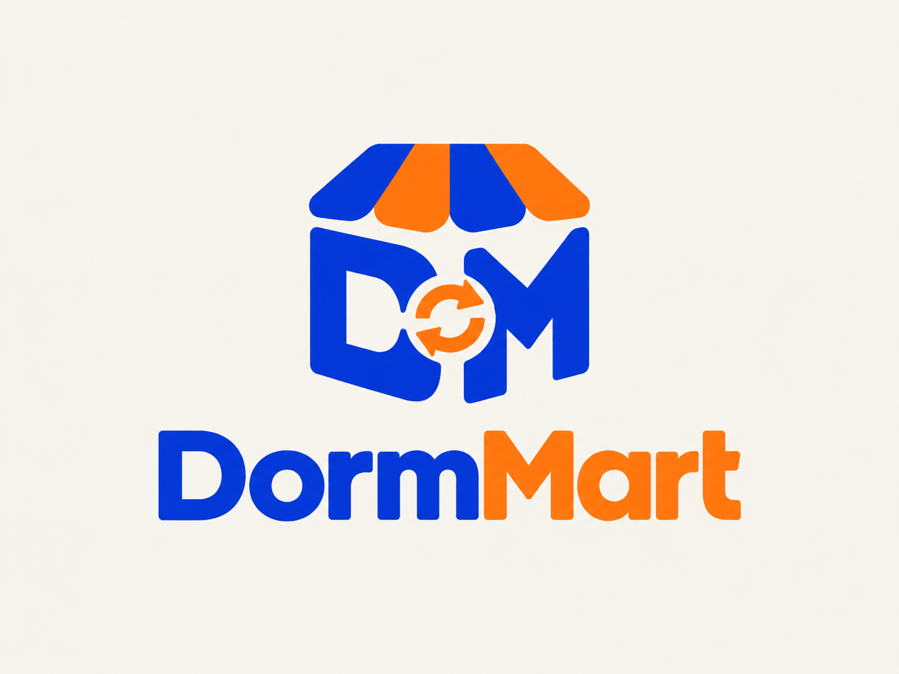

<div align="center">
  

  <h1>DormMart</h1>
  <p><strong>Your campus. Your possibilities.</strong></p>
  <p>A hyperlocal marketplace to rent, buy, sell and share useful things around campus.</p>

  <p>
    <a href="https://dormmart.vercel.app">Live demo</a> ·
    <a href="#getting-started">Run locally</a> ·
    <a href="#features">Features</a> ·
    <a href="#roadmap">Roadmap</a>
  </p>
</div>

---

## About the project

DormMart helps students discover affordable items nearby and give unused belongings another life. Instead of buying something new for a short-term need, users can explore rentals, second-hand purchases and free borrowing—or post a request for something they cannot find.

**Current stage:** a functional frontend prototype built with vanilla HTML, CSS and JavaScript. The marketplace uses mock inventory and browser-local storage. A backend, real authentication and live multi-user communication are future work.

**Live demo:** [dormmart.vercel.app](https://dormmart.vercel.app)

## Tech stack

| Technology | Purpose |
| --- | --- |
| **HTML5** | Semantic page structure, forms, navigation and dialogs |
| **CSS3** | Responsive layouts, design tokens, light/dark themes, transitions and CSS 3D effects |
| **Vanilla JavaScript** | Routing, filtering, listing management, requests, messaging demos and UI interactions |
| **Web Storage API** | Browser-local persistence through `localStorage` and demo session state through `sessionStorage` |
| **Canvas API** | Resizing and compressing uploaded listing photos |
| **Node.js** | Development checks and automated tests; not an application backend |
| **Playwright + Microsoft Edge** | Browser-based interaction and responsive-layout checks |
| **Python HTTP server** | Optional local static preview server |
| **Git & GitHub** | Version control and source hosting |
| **Vercel** | Frontend hosting |

The frontend runs without React, Tailwind, Bootstrap or other frontend frameworks. There is no build step or runtime package installation required. Antigravity is used as the development IDE; design and Google Stitch handoff guidance are included in `docs/`.

## Features

### Discover and compare

- Homepage with curated collections, featured finds and links to the campus wishlist.
- **20 distinct demo items with 20 different bundled photographs**, spanning electronics, furniture, books, music, outdoors, accessories and home essentials.
- Search by keyword and filter by category, rent/buy/share mode, illustrative distance, maximum price, verification flag and saved items.
- Sort by distance, price or newest listing, and remove active filters individually.
- Save favourites and compare up to three items side by side.
- Hover previews on supported desktop devices and full item detail pages with shareable hash routes.
- Quick search from the header or the `/` keyboard shortcut outside form fields.

### List, manage and book items

- Choose **Sell**, **Rent** or **Share for free** when creating a listing.
- Add pricing, condition notes, public pickup area and pickup-address details.
- Upload 1–3 JPG, PNG or WebP photos, with an 8 MB limit per photo and client-side JPEG compression.
- Set rental availability and dates when an item is already rented or on loan.
- View, edit and delete owned listings from **My profile**.
- Mark items available, sold, rented out or on loan.
- Preview rental fees, refundable deposits and a demo guarantor alternative.
- Create and cancel demo booking requests, simulate owner acceptance and check date overlaps.

### Campus request board

- Request an item that is not available in the catalogue.
- Specify rent, buy or free borrowing, category, budget, needed-by date, public pickup area and details.
- Search requests and switch between all, open and your own requests.
- Edit your requests, mark them found, reopen them or delete them with confirmation.
- Offer an available listing you own to a sample request and save or update an offer note.

### Profile and messaging

- Save a display name, campus and short bio.
- Manage your rental, sale and sharing listings in one place.
- Open item-related demo conversations, save messages and simulate replies.
- Access booking history and the item request board from your profile.

### Interface and accessibility

- Consistent DormMart branding across the header, sign-in screen, footer and browser icon.
- Light and dark themes with persistent theme preference.
- Layered hero artwork, pointer parallax, hover effects and subtle transitions.
- Reduced-motion support and a decorative-motion toggle.
- Responsive layouts and mobile navigation for Home, Explore, Requests, Messages and Profile.
- Keyboard focus indicators, labelled controls and form-contrast regression checks.

## Design palette

| Colour | Hex | Role |
| --- | --- | --- |
| Cobalt blue | `#1546D9` | Primary actions and brand emphasis |
| Orange | `#F98318` | Highlights and decorative accents |
| Muted sage | `#DCE4D7` | Collection and community sections |

| Surface | Light mode | Dark mode |
| --- | --- | --- |
| Page background | Warm beige `#E8E2D6` | Deep charcoal `#101419` |
| Cards, navigation and dialogs | Cream `#F2ECDF` | `#1A2129` |
| Inputs and inset panels | Soft sand `#EBE4D7` | `#141A20` |
| Borders and dividers | `#CFC5B5` | `#35414D` |
| Primary text | `#252C27` | `#F0EEE7` |
| Secondary text | `#535D53` | `#AFBBC5` |

Links on dark surfaces use a lighter blue. Product photos keep their original colours, and the supplied logo sits on a light plate in both themes so it stays legible.

## Getting started

### 1. Get the project

```bash
git clone https://github.com/hemanth16-cmd/dormmart.git
cd dormmart
```

The frontend updates are developed on `combined-frontend`. To view that version:

```bash
git switch combined-frontend
```

### 2. Start a local preview

From the repository folder, run:

```bash
python -m http.server 4173 --directory dist
```

Open **[localhost:4173](http://localhost:4173)** in your browser. If your Windows installation uses the Python launcher, replace `python` with `py`.

No frontend dependency installation or build command is needed. A local HTTP server is recommended for consistent browser storage and navigation behaviour.

### 3. Try the demo

1. Enter any non-empty email/phone text and password on the demo sign-in screen. Use dummy details.
2. Explore the catalogue, save an item, compare listings or open a full item page.
3. Select **List an item** to create a listing with photos, then manage it in **My profile**.
4. Open **Requests** to post an item request or offer one of your listings to a sample request.
5. Try the booking and messaging simulations, then switch themes or test the mobile layout.

The default Explore radius is 5 km. Increase it to see all 20 sample items; the tent is intentionally outside that default radius.

## Project structure

```text
dormmart/
├── dist/                       # Static application served locally and on Vercel
│   ├── assets/                 # Product photos, supplied logo and browser icon
│   ├── index.html              # Application shell and page sections
│   ├── styles.css              # Core responsive components
│   ├── theme.css / theme.js    # Theme preference and dark-mode styles
│   ├── motion.css / motion.js  # Animation and motion preferences
│   ├── studio.css / studio.js  # Collections, comparison and quick search
│   ├── campus.css              # Campus edition visual system
│   ├── brand.css               # Logo presentation and final contrast fixes
│   ├── dimension.css           # Hero shelf display, tactile cards, noticeboard and dialogs
│   ├── data.js                 # Mock catalogue, filters, quotes and date rules
│   ├── app.js                  # Core UI, routes and booking flows
│   ├── demo.js                 # Demo sign-in and listing management
│   ├── community.js            # Profile and local messaging
│   ├── item-page.css / item-page.js     # Full item pages and hover previews
│   └── wanted.js               # Browser-local item requests and offers
├── docs/                       # Design decisions and feature handoff guides
├── tests/                      # Domain and browser regression checks
├── .gitignore
└── README.md
```

## Testing

Node.js is required for the automated checks, but not to use the frontend.

Run the filter, pricing and rental-date tests:

```bash
node --test tests/domain.test.cjs tests/rental-dates.test.cjs
```

Browser tests require the Playwright Node package and an installed Microsoft Edge browser. Keep the local preview server running in a separate terminal. In PowerShell:

```powershell
$env:DORMMART_URL = "http://127.0.0.1:4173"
node tests/browser.cjs
node tests/campus.cjs
node tests/profile-messages.cjs
node tests/item-pages.cjs
node tests/theme-parallax.cjs
node tests/theme-contrast.cjs
```

If Playwright is installed outside this project, pass its module path as the first argument to a browser test. Additional focused tests cover listing photos, editing, deletion, availability, dates, comparison and motion.

Checks cover key interaction flows, storage persistence and failures, text handling, responsive widths from 320–1440 pixels, both themes and reduced motion. The contrast test checks form text and placeholders; it is not a complete accessibility certification.

## Demo limitations and data

- **Sign-in is a presentation flow, not real authentication.** No account is created. Contact details and passwords entered into the demo form are not stored or submitted by the app; only a session flag is retained.
- Listings, saved items, requests, offers, profile details and messages are stored locally in the browser. They are not synced between devices or published to other people.
- Demo sessions in the same browser share the same locally stored data. There is no server-enforced ownership or access control.
- Messages and offers are not sent to real recipients. Replies and booking acceptance are explicitly simulated.
- Distances, ratings, verification badges, prices and availability are illustrative. The app does not perform live location tracking or identity verification.
- No payments, deposits, refunds or guarantor verification are processed.
- Uploaded photos and pickup-address details remain in browser storage. Use dummy information and public meetup locations when demonstrating the app.
- Sample photographs are representative images, not evidence of a real item's model or condition.
- Browser storage can be limited or unavailable. Storage errors are surfaced in the interface; clearing site data removes locally saved demo content.

## Documentation and image credits

- [Campus edition and request board](docs/CAMPUS-EDITION.md)
- [Brand and logo integration](docs/BRAND.md)
- [Design strategy and Stitch prompts](docs/DESIGN-AND-STITCH.md)
- [Antigravity handoff workflow](docs/ANTIGRAVITY-HANDOFF.md)
- [Profile and messaging](docs/PROFILE-AND-MESSAGES.md)
- [Rental availability and dates](docs/RENTAL-DATES.md)
- [Full item pages](docs/ITEM-PAGES.md)
- [Motion](docs/MOTION.md) and [theme/parallax](docs/THEME-AND-PARALLAX.md)
- [Original product-photo sources](docs/PHOTO-SOURCES.md)
- [Additional product-photo sources](docs/NEW-PHOTO-SOURCES.md)

Representative product images are bundled from the Unsplash sources recorded above. The DormMart logo was supplied for this project.

## Roadmap

- [ ] Real sign-up, sign-in and account recovery.
- [ ] Backend API and database for users, listings, requests and bookings.
- [ ] Server-side ownership checks, validation and secure photo storage.
- [ ] Live messaging, request responses and notifications.
- [ ] Real location search and distance calculation.
- [ ] Reliable booking availability and owner approval workflows.
- [ ] Reporting, moderation and trustworthy verification processes.
- [ ] Payment and deposit handling, if introduced after backend and security work.

## Feedback and development

Bug reports and feature ideas are welcome through [GitHub Issues](https://github.com/hemanth16-cmd/dormmart/issues). For UI issues, include the page, steps to reproduce, browser, screen size and whether light or dark mode was active. Avoid sharing personal details in screenshots or reports.

Developed by **Hemanth** — [@hemanth16-cmd](https://github.com/hemanth16-cmd).
